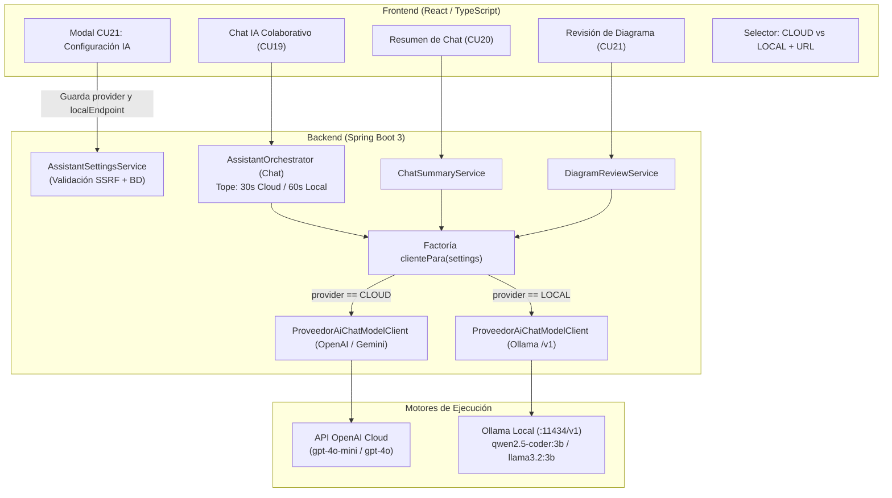

# Plan de Implementación: Dualidad de IA (OpenAI Cloud + Ollama Local) en ModelCollab

> **Versión 2.0 (Revisada y Optimizada)**  
> Incorpora las correcciones y sugerencias técnicas de arquitectura, seguridad de red, compatibilidad Docker y simplificación de código (reutilización de `ProveedorAiChatModelClient`).

Este plan detalla los pasos para habilitar la selección dinámica entre **OpenAI (Nube)** y **Ollama (Local)** por proyecto en el **CU21 (Configuración del Asistente)**, garantizando que el sistema funcione de manera fluida y segura en el entorno de dos laptops (8 GB y 16 GB de RAM), sin alterar ni romper la funcionalidad existente.

---

## 1. Arquitectura y Decisiones Técnicas



### 1.1. Delimitación Estricta de Alcance
- **Módulos que usan IA Local / Nube dinámica (por proyecto):**
  - **CU19:** Chat Colaborativo con el Asistente Senior (`AssistantOrchestrator`).
  - **CU20:** Resumen pedagógico del chat (`ChatSummaryService`).
  - **CU21:** Revisión heurística de diagramas (`DiagramReviewService`).
- **Módulos que NO se tocan (Globales e Inalterados):**
  - **CU16:** Modelado de diagramas por comandos de texto (`AiCommandService`), que sigue usando `AiModelClient` global de OpenAI/Gemini.
  - **CU17:** Importación multimodal de fotos de pizarra (`VisionImportService`), que requiere visión y sigue usando `VisionModelClient` global.

### 1.2. Estrategia de Hardware y Memoria RAM
- **Laptop Servidor (16 GB RAM):**
  - Aloja: PostgreSQL + Backend Spring Boot + Ollama con modelo 3B (~2.2 GB RAM).
  - Cuenta con holgura suficiente para no saturar memoria ni requerir swap en disco.
- **Laptop Cliente (8 GB RAM):**
  - Ejecuta únicamente el navegador web conectado a la aplicación.
  - No corre Ollama ni la base de datos, evitando colapsar sus 8 GB (donde Docker ya consumiría 3.9 GB).

### 1.3. Conectividad y Red (Docker vs Host)
- **Si el backend corre en Docker:** dentro del contenedor, `localhost` es el propio contenedor. Para conectar con Ollama corriendo en el host de Windows, se debe configurar:  
  `http://host.docker.internal:11434/v1`
- **Si el backend corre directo en el host (`./mvnw` o IDE):**  
  `http://localhost:11434/v1`
- **Si se conecta desde la laptop secundaria por red local Wi-Fi:**  
  `http://<IP-PRIVADA-LAPTOP-16GB>:11434/v1`
- **Seguridad y Firewall:**
  - `OLLAMA_HOST=0.0.0.0:11434` abre Ollama a la red sin autenticación. En Windows Defender Firewall se debe habilitar una regla para el puerto 11434 **exclusivamente en redes de tipo Privada / Doméstica**.
  - En el backend, `AssistantSettingsService.validarSettings` validará que la URL pertenezca a loopback (`localhost`, `127.0.0.1`), `host.docker.internal` o rangos privados RFC1918 (`192.168.0.0/16`, `10.0.0.0/8`, `172.16.0.0/12`), bloqueando URLs públicas externas arbitrarias (protección contra SSRF).

### 1.4. Modelo y Rendimiento
- **Modelo seleccionado:** `qwen2.5-coder:3b` (alternativa: `llama3.2:3b`).
- **Consumo RAM:** ~2.2 GB.
- **Rendimiento CPU Intel Core i5 8va gen:** ~8 a 12 tokens/segundo.
- **Timeout adaptativo:** 30 s para Cloud y 60 s para Local.

---

## 2. Fases de Implementación (Orden Recomendado)

### Paso 1: Verificación de Ollama en la Laptop de 16 GB
- [ ] **1.1. Descarga del modelo:**
  ```bash
  ollama pull qwen2.5-coder:3b
  ```
- [ ] **1.2. Configuración de escucha de red:**
  - Configurar variable de entorno en Windows: `OLLAMA_HOST=0.0.0.0:11434`
  - Crear regla en Windows Defender Firewall para permitir tráfico entrante TCP en puerto 11434 en redes privadas.
- [ ] **1.3. Prueba de humo REST con `curl`:**
  - Probar desde Windows directo:
    ```bash
    curl http://localhost:11434/v1/chat/completions -H "Content-Type: application/json" -d "{\"model\":\"qwen2.5-coder:3b\",\"messages\":[{\"role\":\"user\",\"content\":\"Hola\"}]}"
    ```
  - Probar desde el contenedor Docker (si aplica):
    ```bash
    curl http://host.docker.internal:11434/v1/chat/completions -H "Content-Type: application/json" -d "{\"model\":\"qwen2.5-coder:3b\",\"messages\":[{\"role\":\"user\",\"content\":\"Hola\"}]}"
    ```

---

### Paso 2: Backend (Enrutamiento Dinámico y Protección)

- [ ] **2.1. Factoría `clientePara(settings)` reutilizando `ProveedorAiChatModelClient`:**
  - No crear clases duplicadas. `ProveedorAiChatModelClient` ya es compatible con la API `/v1/chat/completions` de OpenAI.
  - Proveer un método/factoría:
    - Si `settings.provider() == CLOUD`: retorna el cliente global de OpenAI/Gemini configurado en `AiProperties`.
    - Si `settings.provider() == LOCAL`: instancia un `ProveedorAiChatModelClient` apuntando a `settings.localEndpoint()` con el modelo local definido por variable de entorno (`OLLAMA_MODEL` por defecto `qwen2.5-coder:3b`) y un timeout de 60 s.
- [ ] **2.2. Ajustar timeouts en `AssistantOrchestrator`:**
  - Permitir que el tope (`TOPE_DEL_MODELO`) sea adaptativo: 30 s para Cloud y 60 s para Local.
- [ ] **2.3. Pasar settings a Resumen y Revisión:**
  - Actualizar `ChatSummaryService` y `DiagramReviewService` para obtener el cliente correspondiente según los `AssistantSettings` del proyecto en curso.
- [ ] **2.4. Reforzar validación anti-SSRF en `AssistantSettingsService.validarSettings`:**
  - Exigir que `localEndpoint` comience con `http://` o `https://`.
  - Validar que el host sea local (`localhost`, `127.0.0.1`, `host.docker.internal`) o una IP privada RFC1918 (`192.168.x.x`, `10.x.x.x`, `172.16.x.x-172.31.x.x`).

---

### Paso 3: Frontend (Web - Modal CU21 e Indicador de Chat)

- [ ] **3.1. Habilitar selector de proveedor en `AssistantSettingsModal.tsx`:**
  - Reemplazar el envío fijo de `provider: "CLOUD"` por el estado del selector:
    - `En la nube (OpenAI)`
    - `Local (Ollama)`
- [ ] **3.2. Campo condicional para `localEndpoint`:**
  - Visible únicamente cuando `provider === "LOCAL"`.
  - Sugerencia/placeholder explicativo:
    - `http://localhost:11434/v1` (si backend corre local).
    - `http://host.docker.internal:11434/v1` (si backend corre en Docker).
    - `http://192.168.1.X:11434/v1` (si se conecta a otra laptop).
- [ ] **3.3. Indicador visual en el Chat:**
  - Mostrar en la cabecera del panel del Asistente la etiqueta correspondiente: `[Cloud: OpenAI]` o `[Local: Ollama]`.

---

### Paso 4: Pruebas y Validación Integral

- [ ] **4.1. Regresión Cero en Modo Cloud:**
  - Ejecutar la suite completa de pruebas unitarias y de integración de backend (`mvn test`).
  - Probar en la web preguntas `@IA`, pedagogía (`Principiante`, `Intermedio`, `Avanzado`), revisión de diagramas y resumen en modo `CLOUD`.
- [ ] **4.2. Pruebas en Modo Local (Misma máquina):**
  - Cambiar el proyecto a `Local (Ollama)`.
  - Probar preguntas `@IA`, verificar tiempo de respuesta (4 a 8 s en CPU i5) y confirmar que las propuestas visuales `[ PROPUESTA_INICIO ... PROPUESTA_FIN ]` se parsean correctamente.
- [ ] **4.3. Prueba Colaborativa (Dos Laptops en Red Local):**
  - Laptop 1 (16 GB): corriendo PostgreSQL + Backend + Ollama.
  - Laptop 2 (8 GB): navegador web conectado a la IP de la Laptop 1.
  - Ambas laptops colaboran en el mismo diagrama y reciben las respuestas de la IA local por WebSockets en tiempo real.

---

## 3. Matriz de Riesgos y Mitigación

| Riesgo potencial | Impacto | Mitigación |
| :--- | :---: | :--- |
| **Ollama apagado al consultar** | Medio | `ProveedorAiChatModelClient` captura `ResourceAccessException` / `ConnectException` y el orquestador publica un mensaje amigable en el chat: *"El servidor local Ollama no responde en [URL]. Verifique que esté iniciado o cambie a Cloud en ajustes"*. |
| **Backend en Docker no ve Ollama** | Alto | El plan define claramente usar `http://host.docker.internal:11434/v1` en lugar de `localhost`. |
| **Firewall de Windows bloquea puerto 11434** | Medio | Se incluye el paso explícito de habilitar la regla de firewall en Windows para redes privadas antes de probar con la segunda laptop. |
| **Ataque SSRF vía URL local arbitraria** | Alto | `validarSettings` en backend restringe los hosts a loopback, `host.docker.internal` y rangos privados RFC1918. |
| **Saturación de RAM en laptop de 8 GB** | Alto | La laptop de 8 GB solo corre el navegador. Ollama y Docker residen exclusivamente en la laptop de 16 GB. |
| **Ruptura de tests automatizados** | Ninguno | Todos los tests usan `FakeChatClient` o mocks con `CLOUD` por defecto; no dependen de Ollama ni de claves reales. |
